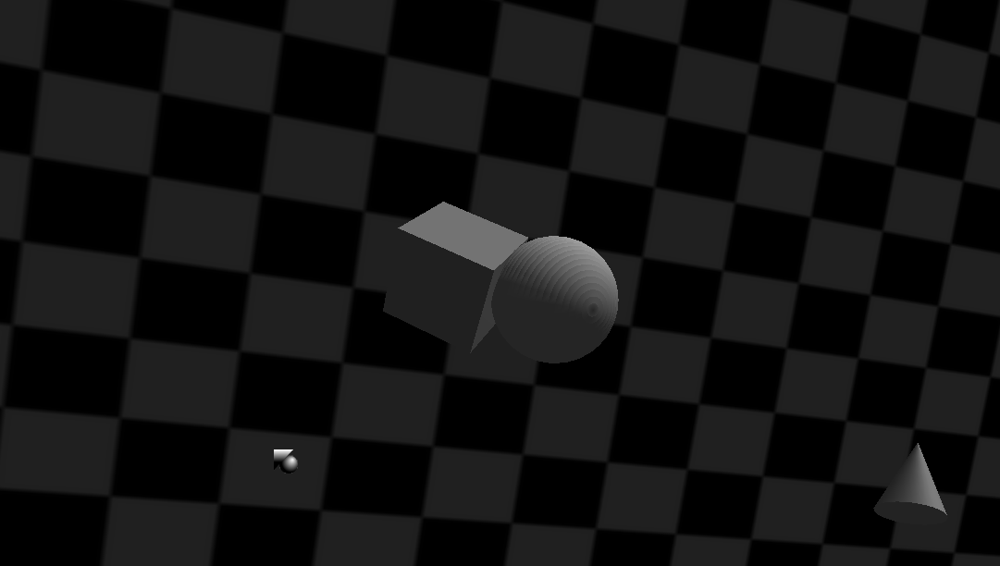
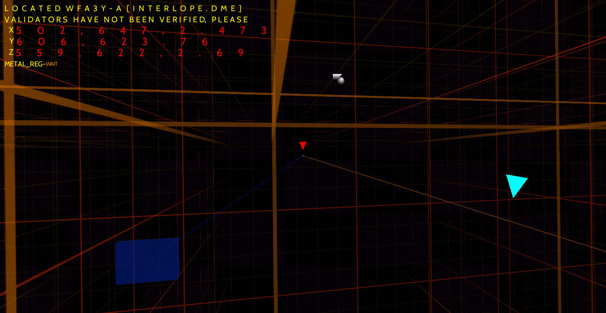

# GLXSourceBox

My version of the SourceBox program from the [INTERLOPER ARG](https://www.youtube.com/playlist?list=PL6ywVNnt0-OpbUDztGZd7n6QjtADOTXY-) by Anomidae.

I wanted to lean more into the 90s feeling that SourceBox gives off by writing it **mostly** from scratch **in raw C11, using an immediate mode OpenGL pipeline**, no CPP in sight :).

i based some code off of [Sierra's Python program](https://github.com/programmer1o1/SourceBox) and using SDL2 and OpenGL, because i am just not gonna write input and graphics from scratch :)

If it isn't obvious by the name, i think sourcebox looks like the Mesa3D demos that also dont load 3D models from disk (not like i would know how to load them...), but rather generate them on the fly (glxgears, glxheads, etc), so i thought of naming this project GLXSourceBox as a nod to those projects

On another note, from my testing, the project compiles with **NO WARNINGS** under default GCC settings (plus the cmake arguments) on both linux and windows. although this may vary from setup to setup :(



## The Menu

When you start the program you will see 3 3D shapes:

- **Cube** — clicking it plays a sound, moves it and starts spinning it.
- **Sphere** — Clicking it cuts the music and displays a screen with the Source missing texture image as background, with a text like "no graphics driver". This more or less crashes the program, but it is intended to recreate the way the program works in INTERLOPER (where it tries to send some data somewhere)
- **Cone** — clicking it plays the cone sound and starts the Voidside scene: A look into the SourceVoid... the camera follows an entity through the void displayed on a grid, meanwhile other elements fly about (other cones, 3d axis, etc)


Screenshot taken on Windows, as the effect breaks on Linux (i have provided a similar effect that does work on linux, but it isnt 1:1 to how it displays in INTERLOPER). Being able to resize the screen to fullscreen is intentional and even though it isnt accurate to INTERLOPER i kept it because it looks cool in my opinion

The whole program uses OpenGL 1.1, as far back as i could go while having the features i needed.

## Controls

- You only need a pointing device, no keyboard needed
- Click the cyan triangle while on the VoidSide to return to the main menu.
- The `Esc` key quits the program.
- Unlike other Sourcebox recreations, you can resize the window (not a bug, its a feature tm that looks cool at least on my monitor)

## Building

CMake, Ninja and a C11 compiler (i tested it on GCC both on windows using MINGW and on Linux, havent tested MSVC or Clang).

### Linux

Install your desired compiler, cmake, ninja, SDL2, SDL2-image, SDL2-ttf and SDL2-mixer, as well as their development files (should work with SDL3Compat if your distro ships that package), and also install the dev files for `libgl` and `libx11`. The program works on Wayland, but needs some x11 headers to compile (GLX features need those headers)

on **Debian-based** distros, execute this command:

```sh
sudo apt install build-essential cmake ninja-build libsdl2-dev libsdl2-image-dev libsdl2-mixer-dev libsdl2-ttf-dev libgl-dev libx11-dev
```

on **Arch-based** distros, execute this command:

```sh
sudo pacman -S base-devel cmake ninja sdl2 sdl2_image sdl2_mixer sdl2_ttf mesa libx11
```

on **Fedora-based** distros, execute this command:

```sh
sudo dnf install gcc gcc-c++ make cmake ninja-build SDL2-devel SDL2_image-devel SDL2_mixer-devel SDL2_ttf-devel mesa-libGL-devel libX11-devel
```

other distros may have to install packages with different names

After installing the required packages, clone the repo and cd into its directory and execute these commands to build the project

```sh
cmake -G Ninja -B build -S . -DCMAKE_BUILD_TYPE=Release
cmake --build build
```

then execute ./build/bin/sourcebox to run the program.

### Windows

Windows is not my main OS, so keep in mind i only tested building this on a Windows 10 machine with Msys2 and MINGW64, MSVC or Clang compilation are **entirely untested**.

if you have a similar build environment setup, i can give some advice. Msys2 packages usually have the same name as arch packages, if some package cant be installed, google is your friend (if someone wants to make a contribution to expand on this be welcome :D)

I did have to do some bullshit to get the windows build to compile so that is why there is vendored glew, glu, glvnd and sdl2 folders, plus a nasty cmake workaround because SDL2 needs 2 ld passes on windows for some weird reasons (they are linker errors, but they arent an issue on linux so what gives??)

after getting the required packages, run these commands (same as linux):

```sh
cmake -G Ninja -B build -S . -DCMAKE_BUILD_TYPE=Release
cmake --build build

```

then execute build\bin\sourcebox.exe to run the program.

## Running

- pass `--seed N` to the program or export the `$SOURCEBOX_SEED` env var to set the random seed to a specific value
- export the `$SOURCEBOX_ROOT` env var to override from where assets are loaded, otherwise the executable's
  directory, its parent directory, and the working directory are checked in order for the assets.
- give the `$SOURCEBOX_GRID` env var a value of either `windows` or `linux` to force one of the two rendering methods (by default, windows rendering breaks on linux only on some hardware from my testing. on linux it defaults to the less accurate but not broken renderer). if the variable is not defined then it is resolved at runtime to be the platform's default

On linux, if launched from a TTY or terminal emulator, the program logs both on stdout and on a log file. on Windows even if you launch from cmd the program only writes the log file. this is because you cant have conditional logging on windows and i didnt want to have a cmd start with sourcebox (the windows version compiles with -mwindows parameter)

The program has **some** macOS logic for logging, but it is mostly the linux code. this code was written from documentation i could find online, and has **not been tested** because i dont own an Apple device, but it should be similar enough to linux for it to just work (although compiling with Clang may be difficult...)

| Platform | Log path                                            |
|----------|-----------------------------------------------------|
| Windows  | `%LOCALAPPDATA%\SourceBox\sourcebox.log`            |
| macOS    | `~/Library/Logs/SourceBox/sourcebox.log`            |
| Linux    | `$XDG_STATE_HOME/sourcebox/sourcebox.log`           |
| Unrecognized by the program         | `~/.local/state/sourcebox/sourcebox.log` by default (~ evaluates to the user profile folder on Windows) |

## Known issues

- Sphere doesnt render correctly. i tried for hours to make it smooth like the other 2 models but even though GLU_SMOOTH is set it still shows up ragged. although when highlighted it does smooth out, so i dont fucking know
- Linux Voidsite renderer is not accurate enough to INTERLOPER, but i didnt find a way to improve it. it only renders accurately on Windows

## Repository layout

```txt
src/      
          audio (simple sdl code to load the sound effects and music)
          core (logging, platform specific code, asset loading and RNG), 
          gl (images and text),
          render (menus, mouse position raycasting, cursor image loading), 
          scenes (main menu and Voidside, driver warning)

assets/   
          fonts, images, sound effects and music

sdl2/     
          MinGW-w64 SDL2 dev package: headers, CMake configs, import tables, some other windows needed bullshit
          SDL2main and the runtime DLLs for Windows builds only, because compiling SDL2 is a pain in the ass on winslop

glew/     
          GLEW 2.3.0, i only vendor the unit i need and headers

glvnd/    
          GL headers used by libGLU during compilation

libglu/   
          libGLU taken from Mesa3D repos, i only use 7 functions :(
```

## License

The project code is WTFPL licensed, mainly because i dont give a shit lmao (just dont throw it into an LLM pretty please).

The vendored third-party libraries have their own licenses, detailed information is found in the [THIRD_PARTY_LIBS](THIRD_PARTY_LIBS) file.
